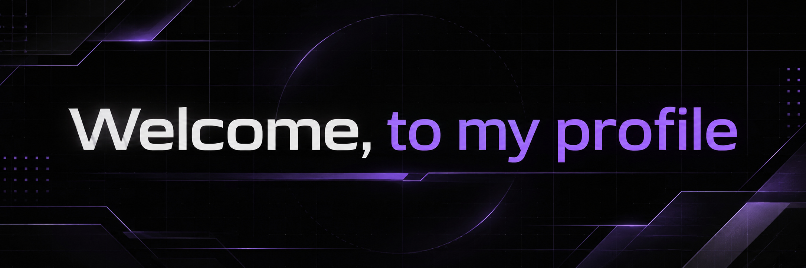

# Marcelo Augusto
### Full Stack Developer | C# · .NET · TypeScript · Next.js

Desenvolvedor focado na construção de aplicações web, APIs e sistemas bem estruturados. Tenho interesse especial em arquitetura de software, desenvolvimento backend e integração entre diferentes tecnologias.

Meu objetivo é desenvolver soluções que vão além de simplesmente funcionar: busco compreender os problemas, tomar boas decisões arquiteturais e escrever código organizado, sustentável e de fácil manutenção.

### Sobre mim
* Estudando e aplicando princípios de arquitetura de software e boas práticas de desenvolvimento.
* Experiência prática na construção de APIs, integração entre serviços e aplicações web.
* Trabalho com ambientes conteinerizados e infraestrutura utilizando Docker.
* Aprendizado contínuo por meio de projetos práticos e aprofundamento técnico.

### 📊 Estatísticas do GitHub

  
  

---

### 🛠️ Tecnologias e ferramentas

### Backend Development

  
  
  
  
  
  
  
  

### Frontend Development

  
  
  
  

### Database & Infrastructure

  
  
  
  
  
  
  

### Design & Development Tools

  
  
  

---

### 🤝 Vamos nos conectar?

Estou aberto a oportunidades profissionais, troca de conhecimentos e conexões com pessoas da área de tecnologia.

  
  
  
  

  <i>Obrigado por visitar meu perfil! 🚀</i>

